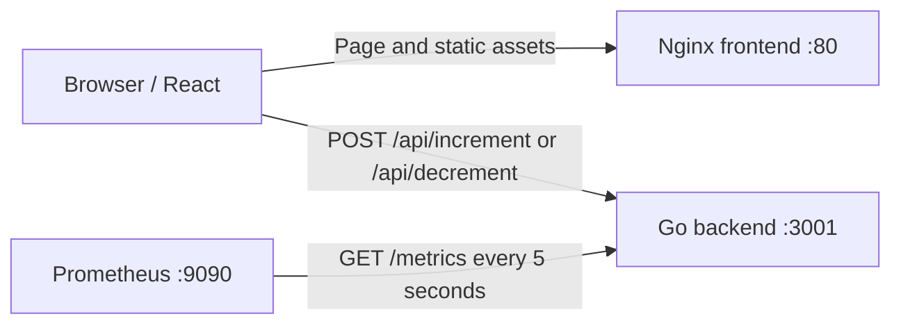

# Prometheus Basic

A small React counter backed by a Go API, with Prometheus metrics and deployment examples for Docker Compose, Kubernetes, and a single-node k3s homelab.

The counter keeps the application simple so the project can focus on the full path from a browser request to a containerized, monitored service.

## What this project covers

- Sending HTTP requests from React to Go.
- Tracking application state with a Prometheus gauge and counter.
- Building Go and React applications with multi-stage Dockerfiles.
- Serving the frontend with Nginx and adding an API reverse proxy for a homelab.
- Running services together with Docker Compose.
- Deploying Pods, Services, and configuration in Kubernetes.
- Troubleshooting image availability, readiness, and node disk pressure.

## Architecture



React sends actions to Go and displays the returned count. Go owns the count and updates its metrics when an action succeeds. Prometheus scrapes Go directly, independently of browser requests.

The checked-in frontend calls `http://localhost:3001/api/...` directly from the browser. Nginx serves static frontend files. This works for the local setup; the homelab instructions below add a reverse proxy so a remote server can be used without embedding its IP in React.

## Quick start: Docker Compose

Install Docker with the Compose plugin and start the Docker engine. Run these commands from the repository root. Ports `8080`, `3001`, and `9090` must be available.

```bash
docker compose -p prometheus-basic up --build -d
docker compose -p prometheus-basic ps
```

The explicit project name keeps generated image and volume names consistent. Allow the services a moment to start before testing.

| Component | Address |
| --- | --- |
| Counter app | http://localhost:8080 |
| Go API health | http://localhost:3001/api/health |
| Raw Go metrics | http://localhost:3001/metrics |
| Prometheus query interface | http://localhost:9090 |
| Prometheus target status | http://localhost:9090/targets |

Check the backend directly, then open the frontend and click its buttons:

```bash
curl -i http://localhost:3001/api/health
curl -X POST http://localhost:3001/api/increment
curl http://localhost:3001/api/count
```

Health returns `{"status":"ok"}`. Count responses use the shape `{"count":1}`; the value depends on previous requests.

View logs or stop the stack:

```bash
docker compose -p prometheus-basic logs -f
docker compose -p prometheus-basic down
```

Compose stores Prometheus history in the `prometheus-data` named volume. Normal `down` preserves it; `down --volumes` deletes it. The Go count is in memory and resets when its process restarts.

## API

| Method | Path | Behavior |
| --- | --- | --- |
| `GET` | `/api/health` | Returns `{"status":"ok"}` |
| `GET` | `/api/count` | Returns the current count |
| `POST` | `/api/increment` | Adds one and returns the updated count |
| `POST` | `/api/decrement` | Subtracts one and returns the updated count |
| `GET` | `/metrics` | Exposes metrics in Prometheus format |

The POST routes need no request body. Both actions update the same process-wide count, protected by a mutex. Negative counts are allowed.

## Metrics

| Metric | Type | Meaning |
| --- | --- | --- |
| `app_count` | Gauge | Current application count; can increase or decrease |
| `app_count_changes_total` | Counter | Number of increment/decrement operations handled by this Go process |

Starting from zero, two increments and one decrement produce:

```text
app_count 1
app_count_changes_total 3
```

The Go client also exposes default runtime/process metrics. Both custom metrics reset when Go restarts.

In Prometheus, confirm that `go-backend` is **UP** on the Targets page. Try these expressions individually:

```promql
app_count
```

```promql
app_count_changes_total
```

```promql
rate(app_count_changes_total[1m])
```

The last expression estimates changes per second over the previous minute. Wait for several scrapes before expecting a useful result. Scraping happens every five seconds; refreshing the query display is a separate action.

## Local Kubernetes

Requirements: a ready Kubernetes cluster, `kubectl`, and app images available to the cluster's container runtime. The manifests in `k8s/` use the `default` namespace in the examples below and ClusterIP Services.

Check that you are targeting the intended cluster:

```bash
kubectl config current-context
kubectl get nodes
```

Build the exact image names referenced by the manifests:

```bash
docker build -f backend/dockerfile -t prometheus-basic-backend:latest ./backend
docker build -f frontend/dockerfile -t prometheus-basic-frontend:latest ./frontend
```

Some local clusters share Docker's image store; others require an explicit image load or a registry. A successful `docker image ls` on the host alone does not prove a Kubernetes node has the image. Load it using your cluster's supported method before continuing. The k3s example below demonstrates exporting and importing images.

Deploy the backend first, followed by the frontend and Prometheus:

```bash
kubectl -n default apply -f k8s/backend.yaml
kubectl -n default rollout status deployment/backend --timeout=120s
kubectl -n default apply -f k8s/frontend.yaml
kubectl -n default apply -f k8s/prometheus.yaml
kubectl -n default rollout status deployment/frontend --timeout=120s
kubectl -n default rollout status deployment/prometheus --timeout=120s
```

Run each port forward in a separate terminal and keep it open:

```bash
kubectl -n default port-forward svc/frontend 8080:80
```

```bash
kubectl -n default port-forward svc/prometheus 9090:9090
```

Also forward the backend in a third terminal; the checked-in React code calls this local address directly:

```bash
kubectl -n default port-forward svc/backend 3001:3001
```

Open the frontend and Prometheus URLs from the Compose table. Stop any Compose stack or older port-forward process that occupies those local ports. A closed forwarding terminal ends access from your computer but leaves the Pods running.

The backend exposes `/api/health`, but the checked-in Deployment does not yet configure liveness or readiness probes. The checked-in Prometheus Deployment uses **`emptyDir` storage: its history is lost when the Pod is replaced**. It is not a persistent homelab configuration.

## Single-node k3s homelab

These instructions adapt the checked-in manifests for an **x86-64 Linux server**. Commands marked Mac run on the development computer; server commands run through your own SSH session. Replace `YOUR_USER`, `YOUR_SERVER`, and `YOUR_SERVER_IP` privately.

### 1. Prepare the frontend for remote access

`localhost` in a browser refers to the computer running that browser. Before building the homelab image, change the request in `frontend/src/App.jsx` to:

```js
const response = await fetch(`/api/${action}`, { method: 'POST' })
```

Create `frontend/nginx.conf`:

```nginx
server {
    listen 80;
    server_name _;

    root /usr/share/nginx/html;
    index index.html;

    location /api/ {
        proxy_pass http://backend:3001;
    }

    location = /metrics {
        proxy_pass http://backend:3001;
    }

    location / {
        try_files $uri $uri/ /index.html;
    }
}
```

In the Nginx stage of `frontend/dockerfile`, add this line after `FROM nginx:stable-alpine`:

```dockerfile
COPY nginx.conf /etc/nginx/conf.d/default.conf
```

Keep the existing copy of `/app/dist`. API requests now follow **browser → Nginx → backend Service → Go**. Keep `proxy_pass` without a trailing `/` to preserve the `/api/` prefix.

### 2. Build portable images on the Mac

From the repository root:

```bash
docker buildx build --platform linux/amd64 \
  -f backend/dockerfile -t homelab-backend:v1 \
  --output type=docker,dest=backend-v1.tar ./backend

docker buildx build --platform linux/amd64 \
  -f frontend/dockerfile -t homelab-frontend:v1 \
  --output type=docker,dest=frontend-v1.tar ./frontend
```

For an ARM64 server, use `linux/arm64`. Use a new image tag and archive filename for subsequent releases.

### 3. Transfer and import

On the server, create a project directory:

```bash
mkdir -p ~/apps/prometheus-basic/k8s ~/apps/prometheus-basic/images
sudo k3s kubectl get nodes
```

On the Mac, copy the archives and manifests:

```bash
scp backend-v1.tar frontend-v1.tar \
  YOUR_USER@YOUR_SERVER:~/apps/prometheus-basic/images/
scp k8s/backend.yaml k8s/frontend.yaml k8s/prometheus.yaml \
  YOUR_USER@YOUR_SERVER:~/apps/prometheus-basic/k8s/
```

On the server, import into k3s's containerd image store:

```bash
sudo k3s ctr -n k8s.io images import ~/apps/prometheus-basic/images/backend-v1.tar
sudo k3s ctr -n k8s.io images import ~/apps/prometheus-basic/images/frontend-v1.tar
sudo k3s ctr -n k8s.io images list -q
```

### 4. Adapt the server copies of the manifests

In `~/apps/prometheus-basic/k8s/backend.yaml`, replace the container's image settings with:

```yaml
          image: homelab-backend:v1
          imagePullPolicy: Never
```

In `~/apps/prometheus-basic/k8s/frontend.yaml`, use:

```yaml
          image: homelab-frontend:v1
          imagePullPolicy: Never
```

Keep `name: backend` and `name: frontend` as container names. Replace the old `image:` lines; do not add duplicate keys.

Replace the frontend's Service document with:

```yaml
apiVersion: v1
kind: Service
metadata:
  name: frontend
spec:
  type: NodePort
  selector:
    app: frontend
  ports:
    - port: 80
      targetPort: 80
      nodePort: 30080
```

For Prometheus, make the same Service change using `name: prometheus`, selector `app: prometheus`, `port: 9090`, `targetPort: 9090`, and `nodePort: 30090`. Leave the backend Service as ClusterIP. The server needs registry access to download the public Prometheus image.

For persistent Prometheus history, also replace its `emptyDir` with a PVC backed by an available StorageClass. Mount it at `/prometheus`, configure write permissions, and use a single replica with `strategy.type: Recreate` to avoid simultaneous writers during updates. The repository does not yet include a complete persistent homelab manifest; without these adaptations, the copied manifest retains temporary storage.

Local-path storage survives Pod replacement but stays on that node. A PVC is not a backup, and local-path's requested size is not an enforced disk quota. See the [provisioner's limitations](https://github.com/rancher/local-path-provisioner#cons).

### 5. Deploy on the server

```bash
sudo k3s kubectl -n default apply -f ~/apps/prometheus-basic/k8s/backend.yaml
sudo k3s kubectl -n default rollout status deployment/backend --timeout=120s
sudo k3s kubectl -n default apply -f ~/apps/prometheus-basic/k8s/frontend.yaml
sudo k3s kubectl -n default apply -f ~/apps/prometheus-basic/k8s/prometheus.yaml
sudo k3s kubectl -n default get pods,svc,pvc
```

After the frontend and Prometheus Pods are Ready, access them from your LAN:

| Component | Address |
| --- | --- |
| Counter app | `http://YOUR_SERVER_IP:30080` |
| API health | `http://YOUR_SERVER_IP:30080/api/health` |
| Raw Go metrics | `http://YOUR_SERVER_IP:30080/metrics` |
| Prometheus | `http://YOUR_SERVER_IP:30090` |

Allow the selected NodePorts through the server firewall only for the intended network. These examples provide neither authentication nor TLS. NodePort access continues after disconnecting SSH; no port-forward process is required.

Preserve your adapted manifests in a separate version-controlled environment directory, such as `k8s/homelab/`, before future deployments. Avoid overwriting those adaptations by recopying the local manifests.

## Development without containers

Use a Go toolchain matching `backend/go.mod` (currently Go 1.27.2) and Node.js compatible with the frontend dependencies (the Docker build uses Node 22).

Start Go in one terminal:

```bash
cd backend
go mod download
go run .
```

From the repository root in another terminal:

```bash
cd frontend
npm ci
npm run dev -- --port 8080 --strictPort
```

Open http://localhost:8080. Go's current CORS configuration allows this exact origin. Stop containers or port forwards occupying ports 8080 and 3001 first.

If you have applied the homelab changes and now use relative API URLs, Vite also needs a development proxy. Add this `server` property alongside `plugins` in `frontend/vite.config.js`:

```js
server: {
  proxy: {
    '/api': 'http://localhost:3001',
    '/metrics': 'http://localhost:3001',
  },
},
```

Production containers use the Nginx proxy instead. See [Vite's proxy documentation](https://vite.dev/config/server-options#server-proxy).

## Repository layout

```text
backend/
  main.go              API, shared count, health endpoint, metrics
  go.mod / go.sum       Go dependency definitions
  dockerfile           Go build stage and minimal runtime image
frontend/
  src/App.jsx          Counter UI and API calls
  dockerfile           Vite build stage and Nginx runtime
k8s/
  backend.yaml         Deployment and ClusterIP Service
  frontend.yaml        Deployment and ClusterIP Service
  prometheus.yaml      ConfigMap, Deployment, temporary storage, Service
compose.yaml           Local three-service stack
prometheus.yml         Compose scrape configuration
```

## Troubleshooting

On k3s, substitute `sudo k3s kubectl` for `kubectl` in these examples.

| Symptom | What to check |
| --- | --- |
| No page on local port 8080 | Check the frontend Pod and restart its port forward; ClusterIP does not publish a host port. |
| Homelab Nginx reports `host not found in upstream` | Make sure the `backend` service exists on the same Compose network or Kubernetes namespace, then restart the frontend. |
| Homelab Nginx returns 502 | Check backend readiness and Service endpoints. If a Compose backend was recreated with a new IP, restart Nginx to refresh its resolved upstream. |
| `ErrImageNeverPull` | Compare the Pod's image name/tag with images imported into the scheduled node's runtime. Reimport the matching archive if needed. |
| `ImagePullBackOff` | Inspect Pod Events for image-name, authentication, registry, network, or platform errors. |
| `Pending` / `Evicted` | Inspect Pod Events and node conditions for capacity problems, taints, or storage failures. |
| An added health probe fails with 404 | Check that it uses `/api/health` on container port `3001`. |
| Prometheus has no samples | Check `/targets`; Go must be reachable at `backend:3001/metrics`. A five-second scrape interval does not automatically refresh the query UI. |

Useful checks:

```bash
kubectl -n default get pods,svc,pvc
kubectl -n default describe pods -l app=backend
kubectl -n default logs deployment/backend --tail=50
kubectl -n default get endpointslices -l kubernetes.io/service-name=backend
kubectl describe nodes
```

For disk pressure on the Linux server:

```bash
df -h /var
df -i /var
sudo du -xhd1 /var/lib
```

Inspect the filesystem that actually backs the container runtime. Free space on another partition does not relieve it. Identify the space consumer before cleanup; preserve PVC data and avoid manually removing runtime files. Disk pressure can take several minutes to clear after sufficient space is recovered.

## Current limitations

- The count and custom metrics are in memory. All clients share one backend process's count; backend replicas would each have independent state.
- The UI initializes to zero and updates from action responses. It does not fetch the current count on page load or synchronize changes made by other clients.
- API failures are logged to the browser console; there is no visible error or loading state.
- Compose persists Prometheus history in a named volume; checked-in Kubernetes manifests use `emptyDir`.
- Local image imports with `Never` are a learning workflow. Registry-backed, versioned images improve recovery when nodes or local images disappear.
- The provided scrape configuration collects application and Go runtime metrics. It does not configure host disk monitoring or alerts.
- The checked-in manifests have no health probes or resource budgets. The examples also have no authentication, TLS, or automated backup setup. Use them on a trusted learning network and adapt them before wider exposure.

## Keeping deployment artifacts out of Git

Commit source files, Dockerfiles, manifests, and dependency lockfiles. Keep image archives, local environment files, credentials, kubeconfigs, dependency directories, and build output out of Git. A `.dockerignore` only affects Docker builds.

The checked-in ignore rules are currently scoped to `frontend/`. Add a root `.gitignore` before staging exported archives or local configuration; include `*.tar`, `*.tar.gz`, `.DS_Store`, `.env`, `.env.*`, `.kube/`, and `kubeconfig`. Use placeholder values in any committed environment example.

## References

- [Docker Compose networking](https://docs.docker.com/compose/how-tos/networking/)
- [Kubernetes Services](https://kubernetes.io/docs/concepts/services-networking/service/)
- [Kubernetes health probes](https://kubernetes.io/docs/tasks/configure-pod-container/configure-liveness-readiness-startup-probes/)
- [k3s image imports](https://docs.k3s.io/import-images/)
- [Prometheus Go instrumentation](https://prometheus.io/docs/guides/go-application/)
- [Prometheus storage](https://prometheus.io/docs/prometheus/latest/storage/)
